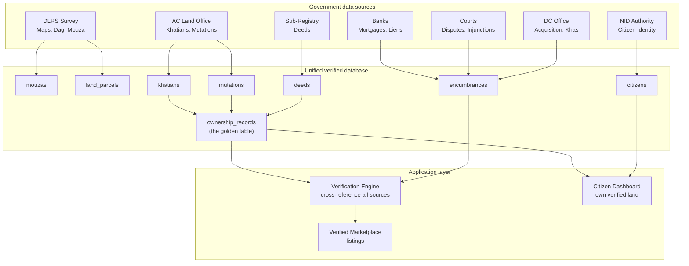

# Bhumisutra

**A unified, government-verified land records database with citizen profiles and a verified marketplace**

| | |
|---|---|
| **Track** | Digital Land Records, Verification & Digitization |
| **Problem chosen** | P3 and P6 |
| **Team** | WeBuildStructures |

---

## Abstract

Land data in Bangladesh is split across separate ministries and offices, so records can't be checked against each other. Bhumisutra brings official land data from seven government sources into one unified database, cross-verifies it, and links every parcel to its owner's NID-based citizen profile. If all records agree, the ownership is **Verified ✓**; if they don't, it is **Flagged ✗**. Only verified owners can list land on the government-based marketplace.

---

## The problem

Land records in Bangladesh are held by different ministries and offices that work separately and are hard to verify:

| Who holds it | What they hold |
|---|---|
| Ministry of Land (AC Land / Union Land Office) | Khatians, mutations, land classification, mouza and dag info |
| Ministry of Law (Sub-Registry Office) | Registered deeds |
| DLRS | Survey maps, mouza maps, dag boundaries |
| Banks | Mortgages and liens |
| District Courts | Land cases, injunctions, verdicts |
| DC Office | Acquisition notices, khas and vested land |
| NID Authority | Citizen identity |

Because these systems are divided:

- A buyer has no single place to confirm who really owns a piece of land.
- A deed, a khatian and a mutation record can disagree, and nobody sees it.
- The same land can be sold more than once, and forged records are hard to catch.
- Mortgages, court cases and acquisition notices sit in other offices, away from the people making the deal.

**What is missing is one place where all of this is brought together, checked against each other, and tied to a real, identified person.**

---

## Our solution

Every piece of land data enters from an **official government source**, gets **cross-verified** against the other sources, and is **linked to a citizen's NID**.

> **Multiple Ministries → Unified Verified DB → Citizen Profiles → Verified Marketplace**

If all records agree: **Verified ✓**. If there is a mismatch: **Flagged ✗**.

### How it works, in four steps

1. **Collect.** Data is received from the seven official sources: khatians and mutations from AC Land, deeds from the Sub-Registry, maps from DLRS, mortgages from banks, cases from the courts, acquisition and khas records from the DC office, identity from the NID Authority.
2. **Unify.** Everything is stored in one relational database, organised around the land parcel (dag).
3. **Verify.** A verification engine cross-references khatian, deed and mutation, and checks mortgages, cases and acquisition notices. The result is saved in `ownership_records`.
4. **Use.** Verified ownership is assigned to the owner's citizen profile. Owners can log in and list their land on the marketplace.

### Architecture



**Reading the diagram:** each government source feeds its own tables. Khatians, deeds and mutations flow into `ownership_records`, the golden table. The Verification Engine reads that table together with `encumbrances`, and only its approved output reaches the Verified Marketplace. Owners see their own verified land on the Citizen Dashboard.

---

## One unified database: 11 tables

The `land_parcels` table is the centre. Every piece of land is a parcel, identified by mouza and dag number (unique per mouza and dag).

| # | Table | Records from | What it holds |
|---|---|---|---|
| 1 | `data_sources` | System config | Registry of every ministry feed: office type, district, API endpoint, last sync |
| 2 | `citizens` | NID Authority | NID number, name (Bangla and English), parents' names, address, photo, login |
| 3 | `mouzas` | DLRS | Mouza number (JL), name, union, upazila, district, division, map sheet |
| 4 | `land_parcels` | DLRS / AC Land | Dag number, area, land type, land class, status, verification score, GeoJSON boundary |
| 5 | `khatians` | AC Land / DLRS | Khatian number, survey type (CS, SA, RS, BS, City Jorip, Diara), owners, shares, document hash |
| 6 | `deeds` | Sub-Registry | Deed number and type, seller and buyer, registration details, value, stamp duty, area, hash, QR data, digital signature |
| 7 | `mutations` | AC Land | Mutation case, previous and new owner, status, officer, link to the deed that triggered it |
| 8 | `ownership_records` | **Cross-referenced** | Current and past owners, share, how acquired, which documents confirm it, verification score |
| 9 | `encumbrances` | Banks / Courts / DC | Mortgages, court cases, injunctions, acquisition notices, liens, tax dues |
| 10 | `marketplace_listings` | Citizens | Listings, asking price, status, and the three automatic checks |
| 11 | `verification_logs` | System | Every verification action, result and who did it |

### How the tables link

| Table | Is linked to |
|---|---|
| `land_parcels` | `mouzas`, `data_sources` |
| `khatians` | `land_parcels`, `citizens` (matched owner), `data_sources` |
| `deeds` | `land_parcels`, `citizens` (seller and buyer), `data_sources` |
| `mutations` | `land_parcels`, `deeds`, `citizens` (previous and new owner), `khatians` |
| `ownership_records` | `land_parcels`, `citizens`, `deeds`, `khatians`, `mutations` |
| `encumbrances` | `land_parcels`, `data_sources` |
| `marketplace_listings` | `land_parcels`, `citizens` (seller), `ownership_records` |

Every record carries a `source_id`, so each piece of data can be traced back to the ministry feed it came from.

### Controlled values used across the tables

| Field | Values |
|---|---|
| Parcel `land_class` | PRIVATE, KHAS_GOVT, VESTED, ACQUIRED, WAQF, DEBOTTAR, OTHER |
| Parcel `status` | CLEAR, DISPUTED, UNDER_ACQUISITION, MORTGAGED, COURT_INJUNCTION, FLAGGED |
| Parcel `verification_status` | UNVERIFIED, PARTIAL, VERIFIED, MISMATCH |
| Deed type | SALE, GIFT_HEBA, INHERITANCE_WARIS, EXCHANGE, PARTITION, POWER_OF_ATTORNEY, MORTGAGE, LEASE |
| Mutation status | APPLIED, UNDER_REVIEW, HEARING_SCHEDULED, OBJECTION_RAISED, APPROVED, REJECTED |
| Encumbrance type | MORTGAGE, COURT_CASE, INJUNCTION, ACQUISITION_NOTICE, LIEN, TAX_DUE |

---

## How ownership is verified

`ownership_records` is the golden table. It tracks current and historical ownership by cross-referencing **all** sources.

| Check (prototype logic) |
|---|
| Deed matches |
| Khatian matches |
| Mutation matches |

- All three agree = **FULLY_VERIFIED** ✓
- Any mismatch = **CONFLICT** ✗, which blocks listing

### What makes someone the clear owner

| Evidence | Source | Weight |
|---|---|---|
| Latest khatian (RS/BS) lists them | AC Land / DLRS | High |
| Registered deed in their name | Sub-Registry | High |
| Mutation approved in their name | AC Land | High |
| No active court case on the land | Courts | Must-pass |
| No active mortgage or lien | Banks | Must-pass |
| No acquisition notice | DC Office | Must-pass |
| NID matches across all documents | NID Authority | Must-pass |

> **Clear Owner = all 3 positive checks (khatian + deed + mutation) + all 4 negative checks (no case, no mortgage, no acquisition, NID match).**

### Citizen profiles

Each person in the system is identified by their NID (10 or 17 digits). Proof of ownership is assigned to the owner's profile. Owners log in and see their verified land on the Citizen Dashboard.

### The verified marketplace

An owner can list a parcel for sale. A listing can only go **ACTIVE** if the system confirms all three:

1. `ownership_verified` = TRUE: `ownership_records` confirms the seller owns it
2. `no_encumbrance` = TRUE: no active mortgage or lien
3. `no_dispute` = TRUE: no court case

If any check fails, the listing is blocked. Listing statuses: DRAFT, ACTIVE, UNDER_NEGOTIATION, SOLD, WITHDRAWN, EXPIRED.

### Protection and audit trail

- **Tamper detection:** khatians and deeds store a SHA-256 hash of the document.
- **Deed authenticity:** deeds also carry QR code data and a digital signature.
- **Audit trail:** every check is written to `verification_logs`: what was verified, the action, the result, details of any mismatch, and who did it (system or officer).

---

## Prototype demo data

The prototype is seeded with mock data. There are no real government APIs: `data_sources` holds about 8 rows, one per office type, and the data is mocked.

| | Happy path (verified land) | Fraud path (mismatch detected) |
|---|---|---|
| **Citizen** | Rahim Uddin, NID 19901234567 | Karim Hossain, NID 19851234568 |
| **Mouza and parcel** | Boalia, JL-45, Rajshahi Sadar. Dag-123, 15 decimals, private, residential | Dag-456, same mouza |
| **Khatian (RS)** | Khatian-456, owner Rahim Uddin ✓ | Owner: **Jamal Ahmed** |
| **Deed** | Sale deed #789, buyer Rahim, 2020 ✓ | Sale deed shows buyer: **Karim** |
| **Mutation** | Approved, new owner Rahim ✓ | **No mutation found** ✗ |
| **Ownership record** | **Score 100, FULLY_VERIFIED** ✓ | **Score 34, CONFLICT** ✗ |
| **Marketplace** | Listed at Tk 25,00,000: **APPROVED** | **BLOCKED**: ownership mismatch |

---

## Frontend features (current build)

### Visual architecture pipeline (`/`)

The home page shows a **live architecture diagram** built with pure CSS — no images. Four connected layers:

| Layer | Shows |
|---|---|
| ① সরকারি উৎস | 7 government source nodes with icons and what data each provides |
| ② একীভূত ডাটাবেস | All 8 table names + the golden `ownership_records` table highlighted |
| ③ ভেরিফিকেশন ইঞ্জিন | 3 cross-reference checks + pass/conflict rule |
| ④ Output | Marketplace, Citizen Dashboard, Deed Verification |

Arrows with labels connect each layer vertically so a viewer understands the entire system in seconds.

### Source-level verification report (`/verify`)

When a user enters a deed number, the result is **not** a flat list of fields. Instead, it shows **one card per government source**, each with:

- **Source name and icon** (📜 সাব-রেজিস্ট্রি, 🏛 এসি ল্যান্ড, 🗺 DLRS, 🏦 ব্যাংক, ⚖ আদালত, 🏢 ডিসি অফিস)
- **Pass/fail badge** — green ✓ or red ✕
- **Detail rows** — every data field from that source
- **Mismatch highlights** — mismatched fields are highlighted in red with an explanation

The verdict bar at the top shows: status badge, score (e.g. ১০০/১০০), and how many sources passed (e.g. ৭/৭).

### Marketplace source attribution (`/listing/[id]`)

Each marketplace listing's detail page uses the **same source-card pattern**. Instead of generic sections (জমির তথ্য, খতিয়ান তথ্য...), each section is attributed to its government source with pass/fail. The sidebar shows a compact verification checklist.

### Demo scenarios

| Deed | Scenario | What happens |
|---|---|---|
| `789` | ✓ Happy path | All 7 sources pass, score 100, FULLY_VERIFIED |
| `1456` | ✕ Fraud detection | Khatian shows different owner (Jamal vs Karim), no mutation, active court case, suspicious hash — score 34, CONFLICT |
| `2100` | ✓ Gift deed (Heba) | Valid gift transfer, all sources pass |

---

## Tech stack

| Layer | Technology |
|---|---|
| Frontend | Next.js, TypeScript |
| Backend | Python, FastAPI |
| Database | PostgreSQL |

---

## Getting started

```bash
# Install dependencies
npm install

# Run development server
npm run dev

# Production build
npm run build
npm start
```
